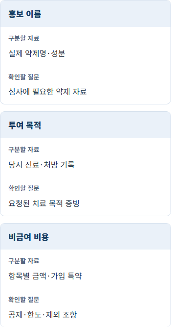
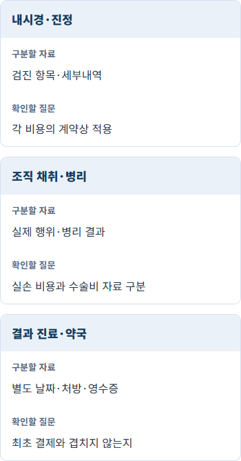
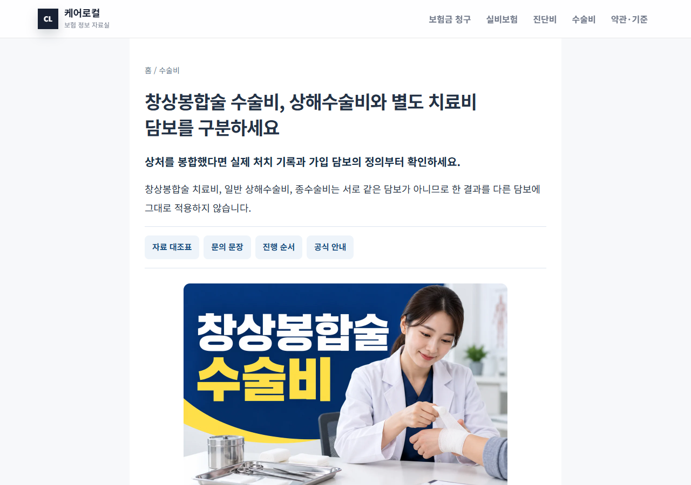

# 추가 발행·보완 작업 기록 — 2026-10-14

요청 범위: 신규 10편과 기존 글 10편. 신규 10편과 기존 10편 모두 발행·보완을 완료하고 공개 반영을 확인했습니다.

## 선정 기준

- 기존 287편의 제목과 본문을 대조했습니다. 같은 진단의 검사·치료·제품·증명 비용을 다른 질문으로 구분했습니다.
- 검색량·광고 단가를 측정한 황금키워드 인증은 아닙니다. 실제 기존 글과 연결되는 구체적인 검색 의도를 기준으로 선정했습니다.
- 의료 안내는 검사 목적을 설명하고, 보험사의 개별 약관 예시는 본인 계약과 대조하는 데 사용합니다.

## 신규 글과 연결할 기존 글

| 신규 키워드 | 신규 글 | 기존 보완 글 |
|---|---|---|
| 유방초음파 실비 | [유방초음파 실비, 검진 추가검사와 이상 소견 후 진료는 어떻게 다를까요?](https://hospital.hbuby.com/silbi/breast-ultrasound-silbi-purpose) | [유방촬영 이상 재촬영·초음파 권고와 확정 진단을 구분하세요](https://hospital.hbuby.com/checkups/mammography-abnormal-followup) |
| 갑상선초음파 실비 | [갑상선초음파 실비, 추적검사·세침검사·고주파 비용을 나누는 법](https://hospital.hbuby.com/silbi/thyroid-ultrasound-test-vs-rfa) | [갑상선 결절 고주파 실비 청구, 시술비·전극 재료비와 서류 확인](https://hospital.hbuby.com/silbi/thyroid-nodule-rfa-silbi-claim) |
| 심장초음파 실비 | [심장초음파 실비 청구, 일반 검사와 약물부하 검사명부터 확인하세요](https://hospital.hbuby.com/silbi/heart-echo-exam-purpose) | [급여와 비급여 차이, 병원 영수증에서 실비 청구 항목 찾기](https://hospital.hbuby.com/silbi/covered-vs-noncovered-medical-costs) |
| 위내시경 조직검사 실비 | [위내시경 조직검사 실비, 내시경·병리·수면 비용을 따로 확인하세요](https://hospital.hbuby.com/silbi/gastroscopy-biopsy-pathology-cost) | [위·대장내시경 준비와 결과 확인](https://hospital.hbuby.com/checkups/endoscopy) |
| 헬리코박터 제균치료 실비 | [헬리코박터 제균치료 실비, 검사·처방약·재검 비용 연결하기](https://hospital.hbuby.com/silbi/h-pylori-eradication-pharmacy-test) | [약값 실비 청구, 처방전과 약제비 영수증 무엇이 필요할까? 병원 영수증과 약국 영수증을 분리해 준비](https://hospital.hbuby.com/silbi/pharmacy-prescription-claim) |
| 비타민 수액 실비 | [비타민 수액 실비, 상품명보다 약제 성분·투여 목적을 확인하세요](https://hospital.hbuby.com/silbi/vitamin-infusion-drug-purpose) | [비급여 치료 뒤 세부내역서를 왜 요청할까?](https://hospital.hbuby.com/silbi/noncovered-itemized-bill-silbi-documents) |
| 청력검사 실비 | [청력검사 실비, 병원 검사와 보청기 구입·지원금 서류 구분하기](https://hospital.hbuby.com/silbi/audiometry-test-vs-hearing-aid) | [보청기 지원금 신청, 구입 전에 장애등록·처방·급여제품을 확인하세요](https://hospital.hbuby.com/treatment-costs/hearing-aid-subsidy-before-purchase) |
| 골다공증 주사 실비 | [골다공증 주사 실비, 골밀도 검사와 약제·투여비 구분법](https://hospital.hbuby.com/silbi/osteoporosis-injection-drug-bill) | [골감소증 판정 골다공증과 구분하고 골절 위험과 원인을 함께 평가하세요](https://hospital.hbuby.com/checkups/osteopenia-bone-density-followup) |
| 하지정맥류 압박스타킹 실비 | [하지정맥류 압박스타킹 실비, 처방·구입 영수증이 있으면 될까요?](https://hospital.hbuby.com/silbi/varicose-compression-stocking-cost) | [하지정맥류 실비, 수술 방법에 따라 확인할 보장 기준과 청구서류](https://hospital.hbuby.com/silbi/varicose-vein-silbi-claim) |
| 창상봉합술 수술비 | [창상봉합술 수술비, 상해수술비와 별도 치료비 담보를 구분하세요](https://hospital.hbuby.com/surgery-benefit/wound-suture-specific-rider) | [상해 종수술비 분류표는 어디서 확인할까? 골절·인대 수술명 대조법](https://hospital.hbuby.com/surgery-benefit/injury-surgery-classification) |

## 출처와 범위

- 서울아산병원·질병관리청의 검사/질환 설명, KB손해보험의 담보별 서류, 삼성화재의 실제 약관 및 공식 심사 안내를 확인했습니다.
- 실손 예시는 무배당 삼성화재 다이렉트 2605.1 계약전환용 약관입니다. 비급여 주사·기구 구입비의 제외와 예외를 읽었으며 전 계약 공통 규칙으로 제시하지 않습니다.
- 봉합술 예시는 무배당 삼성화재 간편보험 2601.3의 창상봉합술 치료비 특별약관(본문 524쪽)입니다. 해당 상품의 대상표와 일반 상해 종분류표를 구분했습니다.
- 첫 PDF 조회는 일부 HTTP 클라이언트에서 411 오류가 났으나 urllib 요청으로 원문을 정상 조회했습니다. 영구적으로 고장 난 링크로 판단하지 않았습니다.

## 검증 기록

- 중복 검토: `NEXT_20_DUPLICATE_REVIEW_2026-10-14.json`
- 출처 본문과 적용 범위: `NEXT_20_SOURCE_BODY_2026-10-14.json`
- 발행별 공개 확인: `NEXT_20_PUBLIC_new_2026-10-14.json`
- 보완별 공개 확인: `NEXT_20_PUBLIC_reinforce_2026-10-14.json`

## 완료 결과

- 신규 10편과 기존 10편을 한 편씩 검사·커밋·배포하고 공개 본문을 확인했습니다. 최종 내용 커밋: `6221fa0`.
- 기존 글의 관련 섹션을 교체·확장했습니다. 공식 상세 버튼, 비용 대조표, 담보별 문의 문장과 새로운 글 연결을 넣고 반복된 연결 블록·생성 이미지 안내는 줄였습니다.
- 기존 제목·URL·이미지와 내부 링크를 보존했습니다. 발행일 메타데이터가 있던 글은 그대로 유지했으며, 기존 내시경 안내에 없는 과거 발행일을 임의로 만들지 않았습니다.
- 내시경 안내에는 기존에 없던 이미지 3장, 공식 안내 버튼과 Article·OG 정보를 추가했습니다.
- 360·390·1280px에서 로컬 60개와 공개 60개 화면을 검사해 모두 통과했습니다. 이미지 60개 배치와 공식 버튼 54개 배치를 확인했습니다.
- 20편의 공개 `<head>`와 `<main>`이 최신 로컬 파일과 일치합니다. 외부 공식 URL 25개는 HTTP 200 응답을 확인했고 중요 출처는 원문 내용을 별도로 읽었습니다.
- 새 글 10편의 제목·H1·Article headline과 설명이 일치합니다. 사이트 검사에서 HTML 324개 로컬 링크, 사이트맵 URL 322개와 canonical, 카탈로그 297개가 정상이며 Python 5개·Node 10개 테스트가 통과했습니다.
- 글이 공개되었다는 사실과 검색 색인은 별개입니다. 이번 작업에서 Google·네이버 색인, 순위 상승이나 수익 성과는 확인하지 않았습니다. 광고 요청을 차단한 화면 검사로 실제 광고를 포함한 사용자 체감이나 현장 Core Web Vitals를 측정한 것은 아닙니다.

## 최종 확인 파일

- `NEXT_20_COMPLETE_2026-10-14.json`
- `NEXT_20_FINAL_AUDIT_2026-10-14.json`
- `NEXT_20_PRESERVATION_2026-10-14.json`
- `NEXT_20_CONTENT_METADATA_2026-10-14.json`
- `NEXT_20_QA_new_public_1_3_2026-10-14.json`
- `NEXT_20_QA_new_public_4_10_2026-10-14.json`
- `NEXT_20_QA_reinforce_public_2026-10-14.json`

## 공개 화면 예시

