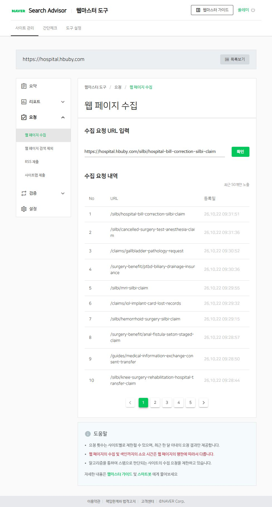
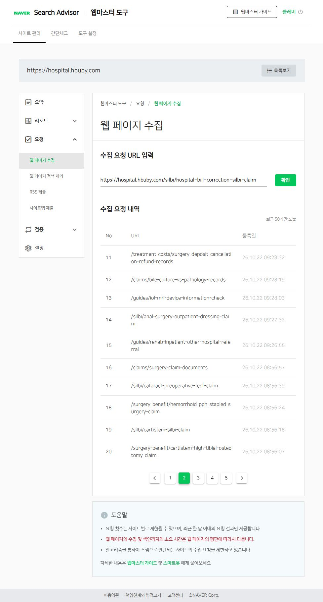

# 후속 5편 발행 및 네이버 수집 요청 보고

작업일: 2026-10-22. 승인된 기획 순서대로 발행하고 공개 반영을 확인했다.

## 신규 5편

1. [재활병원 입원 중 수술병원 외래를 가야 한다면? 진료의뢰·수납 확인 순서](https://hospital.hbuby.com/guides/rehab-inpatient-other-hospital-referral) — `cf2579a`
2. [치루 수술 후 소독·드레싱 비용, 외래 처치와 수술비를 어떻게 나눌까?](https://hospital.hbuby.com/silbi/anal-surgery-outpatient-dressing-claim) — `3b9c37c`
3. [백내장 수술 후 MRI 예약, 인공수정체 제품 정보를 어디에 확인할까?](https://hospital.hbuby.com/guides/iol-mri-device-information-check) — `cf71041`
4. [담도 배액 후 배양검사 결과지를 받았다면? 조직검사와 다른 항목 확인법](https://hospital.hbuby.com/claims/bile-culture-vs-pathology-records) — `55db102`
5. [수술 취소 후 예약금이 안 돌아온다면? 선납 진료비·검사비와 구분해 문의하기](https://hospital.hbuby.com/treatment-costs/surgery-deposit-cancellation-refund-records) — `1efbef1`

## 기존 글 연결

기존 10편에 주제에 맞는 안내 문장과 새 글 내부링크를 추가했다. 새 글에서도 관련 기준 글로 연결한다. 기존 URL과 제목은 유지했다.

- https://hospital.hbuby.com/silbi/knee-surgery-rehabilitation-hospital-transfer-claim
- https://hospital.hbuby.com/guides/medical-information-exchange-consent-transfer
- https://hospital.hbuby.com/surgery-benefit/anal-fistula-seton-staged-claim
- https://hospital.hbuby.com/silbi/hemorrhoid-surgery-silbi-claim
- https://hospital.hbuby.com/claims/iol-implant-card-lost-records
- https://hospital.hbuby.com/silbi/mri-silbi-claim
- https://hospital.hbuby.com/surgery-benefit/ptbd-biliary-drainage-insurance
- https://hospital.hbuby.com/claims/gallbladder-pathology-request
- https://hospital.hbuby.com/silbi/cancelled-surgery-test-anesthesia-claim
- https://hospital.hbuby.com/silbi/hospital-bill-correction-silbi-claim

## 근거와 검증

- 공식 자료·적용 범위: [source-review.md](source-review.md). 예약금은 현행 고시 제2025-14호와 별표2의 품목 범위를 확인했고 일반 질병수술에 성형수술 환급률을 적용하지 않았다.
- 배양검사 글은 이용 제한이 있는 전문 지침을 제외하고 공개 병원·심평원 안내로 근거를 조정했다.
- 신규 글 5편 각각 로컬 및 공개 사이트에서 360·390·1280px를 실제 측정했다(총 30개 화면 조건). 가로 넘침·이미지 로딩·본문 이동을 확인했다.
- 공식 상세페이지 버튼은 모바일 간격·줄바꿈을 보완했다. 생성 이미지 15장은 assets/images/에 WebP로 배치했으며 프롬프트는 image-prompts.json에 있다.
- 공개 신규5·기존10, 총15편의 HTTP 200, 본문·head 일치, canonical, noindex 부재, 내부링크 및 이미지45개 응답을 확인했다.
- 각 발행의 프로젝트 check 명령이 통과했다. 카탈로그 392편, 사이트맵417주소. 광고 설정은 변경하지 않았다.
- 기존 POSTING_GUIDELINES.md 변경 및 무관한 사용자 파일은 보존했다.

## 네이버 요청 결과

신규5편과 내부링크를 넣은 기존10편 모두 요청 목록의 URL·등록 시각으로 접수를 확인했다.

| URL | 등록 시각 | 상태 |
|---|---|---|
| https://hospital.hbuby.com/guides/rehab-inpatient-other-hospital-referral | 26.10.22 09:26:55 | 접수 확인 |
| https://hospital.hbuby.com/silbi/anal-surgery-outpatient-dressing-claim | 26.10.22 09:27:32 | 접수 확인 |
| https://hospital.hbuby.com/guides/iol-mri-device-information-check | 26.10.22 09:28:03 | 접수 확인 |
| https://hospital.hbuby.com/claims/bile-culture-vs-pathology-records | 26.10.22 09:28:19 | 접수 확인 |
| https://hospital.hbuby.com/treatment-costs/surgery-deposit-cancellation-refund-records | 26.10.22 09:28:32 | 접수 확인 |
| https://hospital.hbuby.com/silbi/knee-surgery-rehabilitation-hospital-transfer-claim | 26.10.22 09:28:44 | 접수 확인 |
| https://hospital.hbuby.com/guides/medical-information-exchange-consent-transfer | 26.10.22 09:28:50 | 접수 확인 |
| https://hospital.hbuby.com/surgery-benefit/anal-fistula-seton-staged-claim | 26.10.22 09:28:57 | 접수 확인 |
| https://hospital.hbuby.com/silbi/hemorrhoid-surgery-silbi-claim | 26.10.22 09:29:15 | 접수 확인 |
| https://hospital.hbuby.com/claims/iol-implant-card-lost-records | 26.10.22 09:29:32 | 접수 확인 |
| https://hospital.hbuby.com/silbi/mri-silbi-claim | 26.10.22 09:29:55 | 접수 확인 |
| https://hospital.hbuby.com/surgery-benefit/ptbd-biliary-drainage-insurance | 26.10.22 09:30:36 | 접수 확인 |
| https://hospital.hbuby.com/claims/gallbladder-pathology-request | 26.10.22 09:30:52 | 접수 확인 |
| https://hospital.hbuby.com/silbi/cancelled-surgery-test-anesthesia-claim | 26.10.22 09:31:36 | 접수 확인 |
| https://hospital.hbuby.com/silbi/hospital-bill-correction-silbi-claim | 26.10.22 09:31:51 | 접수 확인 |

남은 요청: 0개. **요청 접수는 실제 수집·색인 완료를 의미하지 않는다.** 현재 개별 실제 색인 완료는 확인하지 않았다.

증거: naver-request-status.json, 개별 naver-receipt-01~15.txt, 최종 요청 목록 1·2페이지 화면.

