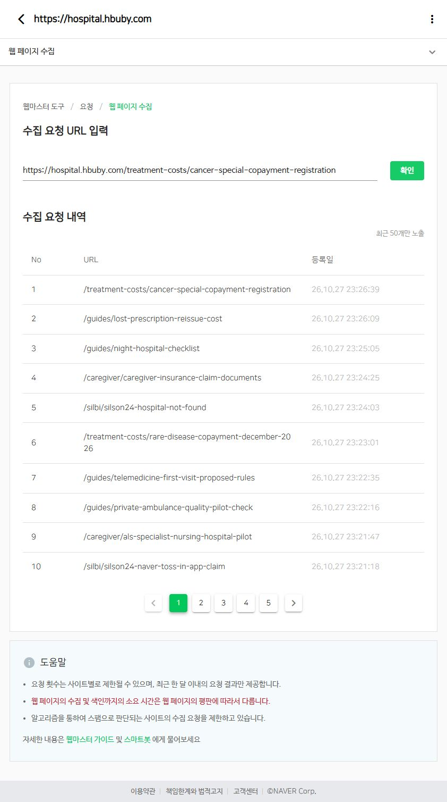

# 재편 우선순위 5편 발행·연결·네이버 수집 요청 결과

작업일: 2026-10-27. 신규 5편을 한 편씩 검수·커밋·push하고 직전 글의 공개 반영을 확인한 뒤 다음 글을 배포했다.

## 완료 상태

- 신규 5편 발행 및 정확한 공개 본문 반영 확인. 전체 카탈로그 437→442편, 공개 사이트맵 462→467 URL.
- 기존 글 5편에 문맥을 설명하는 링크를 추가하고 새 글에서도 기존 글로 연결. 기존 본문 텍스트 보존 대조 통과. 카테고리·사이트맵·카탈로그 갱신.
- 대표 이미지 5장과 본문 이미지 10장을 내장 image_gen으로 생성·시각 검수·WebP 저장. 이미지 15개 모두 공개 HTTP 200 및 브라우저 로딩 확인.
- 신규 각 글을 360/390/1280px에서 로컬·공개 화면으로 점검. 공개 15개 크기 조합에서 페이지 가로 넘침 없음. PC 본문 폭 800px, 표는 내부 가로 스크롤. 지연 로딩 이미지는 실제 본문 위치로 이동해 재확인.
- `pnpm run check`로 package.json의 check 전체 실행. 마지막 결과: 721 HTML 링크, 467 canonical/사이트맵 URL, Python 5개와 Node 10개 테스트 통과. `npm`이 PATH에 없어 번들 Node·pnpm으로 동일 스크립트를 실행.
- 신규 5개와 수정 기존 글 5개: 네이버 요청 내역에 등록 시각과 URL을 최종 확인, 총 10건 접수됨. 요청 접수는 실제 색인 완료가 아니다. 색인 상태 재검사는 이번 결과에 포함하지 않음.
- 기존 사용자 수정 `docs/POSTING_GUIDELINES.md`를 변경하거나 커밋하지 않았다. 광고 설정 변경 없음.

## 발행 목록

|순서|공개 글|핵심 시행 구분|연결 기존 글|커밋|
|---|---|---|---|---|
|1|[실손24 네이버·토스 청구, 앱에서 전송한 뒤 접수까지 확인하는 법](https://hospital.hbuby.com/silbi/silson24-naver-toss-in-app-claim)|플랫폼 연계 서비스 이용 안내|[/silbi/silson24-hospital-not-found](https://hospital.hbuby.com/silbi/silson24-hospital-not-found)|cb8698a|
|2|[루게릭병 전문요양병원 시범사업, 입원 상담 전에 확인할 것](https://hospital.hbuby.com/caregiver/als-specialist-nursing-hospital-pilot)|11월 시행 계획·참여기관 공모 단계|[/caregiver/caregiver-insurance-claim-documents](https://hospital.hbuby.com/caregiver/caregiver-insurance-claim-documents)|d5dd280|
|3|[민간구급차 인증제 시범사업, 병원 이송 예약 전 확인할 것](https://hospital.hbuby.com/guides/private-ambulance-quality-pilot-check)|10월 21~30일 업체 신청·12월 결과 발표 예정|[/guides/night-hospital-checklist](https://hospital.hbuby.com/guides/night-hospital-checklist)|58a1c07|
|4|[비대면진료 초진·7일 처방 변경안, 지금 적용되는 기준과 구분하세요](https://hospital.hbuby.com/guides/telemedicine-first-visit-proposed-rules)|10월 19일~11월 9일 입법예고·12월 24일 법 시행 예정|[/guides/lost-prescription-reissue-cost](https://hospital.hbuby.com/guides/lost-prescription-reissue-cost)|0e8cffa|
|5|[희귀질환 산정특례 7% 인하 예정, 12월 전에 확인할 비용과 등록](https://hospital.hbuby.com/treatment-costs/rare-disease-copayment-december-2026)|현재 10% 안내·2026년 12월 7% 인하 계획|[/treatment-costs/cancer-special-copayment-registration](https://hospital.hbuby.com/treatment-costs/cancer-special-copayment-registration)|1042e82|

## 검토한 범위와 제한

- 실손24: 금융위의 10월 7일 플랫폼 개선 안내와 현재 실손24 공개 메뉴·접수 FAQ 확인. 개인 네이버·토스 계정의 로그인 후 화면이나 실제 보험금 접수를 대신 확인한 것은 아님. 버튼 위치를 고정하지 않고 메뉴·정보 대조 중심으로 작성.
- 루게릭병: 복지부 11월 시행 계획과 심평원 참여기관 공모를 구분. 선정 기준을 개인 입원 조건으로 바꾸지 않았고 특정 병원의 현재 입원·빈 병상은 보장하지 않음. 심평원 페이지 직접 요청은 시간초과가 있었으며, 검색 도구의 공식 공모 본문과 복지부 본문으로 교차 확인.
- 민간구급차: 10월 업체 신청 및 12월 결과 발표 예정으로 작성. 현재 인증업체 명단처럼 제시하지 않음. 비용표는 검증하지 않은 전국 단일 금액 대신 견적 질문으로 구성.
- 비대면진료: 10월 19일~11월 9일 입법예고, 12월 24일 개정법 시행 예정과 현재 시범사업 지침을 분리. 7일·6개월·동일 지역 기준을 현재 공통 요건으로 쓰지 않음.
- 희귀질환: 공단의 현재 10% 안내, 정부의 12월 7% 인하 계획을 구분. 정확한 적용일과 확정 세부고시는 발행 완료로 확인했다고 주장하지 않음. 비급여 제외와 조건을 둔 가상 계산을 제공.

## 네이버 최종 접수 기록

|URL|상태|등록 내역|
|---|---|---|
|https://hospital.hbuby.com/silbi/silson24-naver-toss-in-app-claim|접수됨|1  /silbi/silson24-naver-toss-in-app-claim  26.10.27 23:21:18|
|https://hospital.hbuby.com/caregiver/als-specialist-nursing-hospital-pilot|접수됨|1  /caregiver/als-specialist-nursing-hospital-pilot  26.10.27 23:21:47|
|https://hospital.hbuby.com/guides/private-ambulance-quality-pilot-check|접수됨|1  /guides/private-ambulance-quality-pilot-check  26.10.27 23:22:16|
|https://hospital.hbuby.com/guides/telemedicine-first-visit-proposed-rules|접수됨|1  /guides/telemedicine-first-visit-proposed-rules  26.10.27 23:22:35|
|https://hospital.hbuby.com/treatment-costs/rare-disease-copayment-december-2026|접수됨|1  /treatment-costs/rare-disease-copayment-december-2026  26.10.27 23:23:01|
|https://hospital.hbuby.com/silbi/silson24-hospital-not-found|접수됨|1  /silbi/silson24-hospital-not-found  26.10.27 23:24:03|
|https://hospital.hbuby.com/caregiver/caregiver-insurance-claim-documents|접수됨|1  /caregiver/caregiver-insurance-claim-documents  26.10.27 23:24:25|
|https://hospital.hbuby.com/guides/night-hospital-checklist|접수됨|1  /guides/night-hospital-checklist  26.10.27 23:25:05|
|https://hospital.hbuby.com/guides/lost-prescription-reissue-cost|접수됨|1  /guides/lost-prescription-reissue-cost  26.10.27 23:26:09|
|https://hospital.hbuby.com/treatment-costs/cancer-special-copayment-registration|접수됨|1  /treatment-costs/cancer-special-copayment-registration  26.10.27 23:26:39|

## 증거와 재현 자료

- `public-audit.json`: 공개 본문/제목 일치, canonical, 이미지 응답, 양방향 내부링크 확인.
- `verified-public-qa.json`: 브라우저 도구에서 최종 확인한 15개 크기별 결과와 스크린샷 대응. `browser-qa.json`은 중간 수집 파일로 최종 판정에 사용하지 않음.
- `parent-preservation.json`: 기존 본문 텍스트 보존 확인.
- `source-review.json`, `fsc-official.txt`, `telemedicine-official.txt`, `silson24-faq.txt`: 공식 근거·검토 범위.
- `duplicate-body-review.json`: 관련 기존 HTML 본문 중복 대조.
- `image-prompts.md`, `image-sources.json`, `image-contact-sheet.jpg`: 내장 이미지 생성 방식·프롬프트·원본/최종 자산 대응과 검수. 최종 WebP는 `/assets/images/`의 해당 5개 접두사별 thumb/body1/body2 파일.
- `naver-01.txt`~`naver-10.txt`, `naver-results.json`, `naver-final.png`: 요청별 등록 내역.

입력 초기에 상대경로가 폼 검증에 걸려 전체 URL 형식으로 수정했다. 일부 브라우저 대기 선택자가 먼저 만료됐지만 네이버의 오류·할당량 초과 응답은 없었으며, 해당 요청의 최종 등록 내역 확인 뒤에만 다음 주소로 진행했다. 중복 재제출은 하지 않았다.
